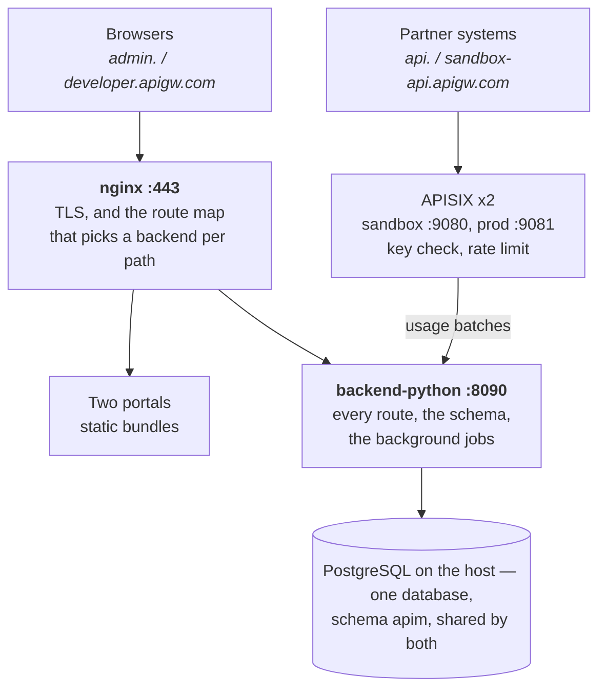

# Configure the API Gateway

Step by step, from nothing to a platform carrying partner traffic. Written against the code on
branch `python-migration`.

Companion documents: [monitoring and error checking](monitoring-and-errors.md), and
[hosting in production](production.md).

## At a glance



Nothing reaches the backend except through nginx. `backend-python` serves every route, owns the
schema and runs the background jobs; `backend-java` is retired and no longer starts with the stack,
kept only on its own compose profile for the parity gates.

Four more containers support them: `etcd` (gateway configuration), `valkey` (rate-limit counters),
two mock upstreams, and a `keycloak` that nothing currently connects to.

## Before you start

Four things have to exist before the first command, and three of them are outside this repository.

| What | Why it is needed | Check it with |
| --- | --- | --- |
| A container runtime | Runs the twelve containers. Docker Engine on Linux or WSL2, Rancher Desktop and Podman are free; **Docker Desktop needs a paid subscription** above 250 staff or $10M revenue | `docker version` |
| PostgreSQL 17 or 18, reachable from the containers | Holds everything. The stack points at the host's own instance by default, not a container, so the data survives `docker compose down` | `psql -U postgres -c 'select version()'` |
| Node 20+ | Only for the operator tools in `infra/tools` — minting a token, the WebCrypto interop check | `node --version` |
| Four DNS names resolving to the host | nginx serves a different site per name and refuses anything else outright | `curl -k https://admin.apigw.com` |

On a developer machine the four names go in the hosts file
(`C:\Windows\System32\drivers\etc\hosts`, or `/etc/hosts`), all pointing at `127.0.0.1`:

```
127.0.0.1 admin.apigw.com developer.apigw.com api.apigw.com sandbox-api.apigw.com
```

The two portals are served on the first two names; partners call the last two. They are separate
names rather than paths so that a partner's traffic and an administrator's never share an origin.

## Step 1 — the database

Run the setup script once, as the PostgreSQL superuser. It creates the login role `apigw`, the
database `apigw` and the schema `apim`, and is safe to re-run.

```bash
psql -U postgres -h localhost -f infra/postgres/local-setup.sql
```

It deliberately does not set the role's password — that would put it in a file. Set it
interactively, then put the same value in `DB_PASSWORD` in `infra/.env`:

```bash
psql -U postgres -h localhost -d apigw -c "\password apigw"
```

**No tables are created here.** `backend-python` applies the migrations at startup and records what
it has run in `apim.flyway_schema_history` — the same ledger Flyway used, so the handover from
`backend-java` needed no migration of state. Set `RUN_MIGRATIONS=false` where migrations are run as
a separate step before a rollout.

The run holds a PostgreSQL advisory lock, so two instances starting together cannot both decide the
same file is unapplied.

The migrations live in `backend-python/migrations/` and run in order:

| Migration | What it adds |
| --- | --- |
| `V1`–`V7` | APIs, partners, keys, documentation, partner users, the error log, products and portal pages |
| `V8` | Renames the `EDITOR` role to `DEVELOPER` and adds `change_request`, the approvals queue |
| `V9` | Adds `product_assignment.approval_reference`, the authority recorded against every access mapping |

## Step 2 — secrets

Copy `infra/.env.example` to `infra/.env` and fill it in. That file is git-ignored and is the only
place these values live.

```bash
cp infra/.env.example infra/.env
```

The three secrets below are **shared by both control planes**. They are not per-service settings:
nginx decides per request which service answers, so a value that differs between them is two
services disagreeing about what the platform allows.

| Value | Generate with | If the two disagree |
| --- | --- | --- |
| `AUTH_JWT_SECRET` | `openssl rand -base64 48` | A session minted by whichever service served the sign-in is rejected by the other, so the portal logs people out at random |
| `CRYPTO_MASTER_KEY` | `openssl rand -base64 32` | One service cannot read what the other encrypted — today the partners' IPV salts. Must decode to exactly 32 bytes, and standard base64, not base64url |
| `PAYLOAD_PRIVATE_KEY` | `openssl genpkey -algorithm RSA -pkeyopt rsa_keygen_bits:2048` | The portal encrypts to one public key; whichever service did not get the matching private key refuses every call it receives |

The PEM goes on **one line**, with its newlines written as the two characters `\n`, which both
services unescape. This one is worth care: `.env` takes one `KEY=VALUE` per line, so a PEM pasted in
with its real line breaks does not merely fail to load — **every `docker compose` command then
fails**, naming a line of base64, and the stack can be neither started nor stopped until it is
fixed. Shell one-liners get this wrong easily; both `awk` and `sed` turned the escape back into real
newlines in testing. Use something that does not re-interpret it:

```bash
python -c "import sys;print(open(sys.argv[1]).read().strip().replace(chr(10),chr(92)+'n'))" key.pem
```

There are three more values that are shared but not secret in the same way: `USAGE_INGEST_TOKEN`,
which the gateways present on every usage batch, and the two APISIX admin keys. Both control planes
configure both gateways, so these have to match as well.

**Changing `CRYPTO_MASTER_KEY` later is not a restart.** Anything already encrypted under the old
key becomes unreadable, so a rotation means decrypting and re-encrypting the stored values first.
Settle it before partners exist.

Outside production, every one of these may be left empty: both services fall back to built-in
development values, which is what lets a developer machine run with no setup. Those fallbacks are in
the repository and are worthless as secrets — the production profile refuses to start without real
ones, deliberately.

### Two hardening settings in the same file

Both are in `.env.example` and both should be left exactly as they come for local work.

`NGINX_HSTS` is empty, and must stay empty here. It is the `Strict-Transport-Security` header nginx
serves, and the local certificate is self-signed on names under a domain nobody running this stack
owns — so a browser told to pin them to https keeps doing it for the full `max-age` after the
containers are gone, with no way to serve plaintext again and clear it. Set it only with a real
certificate on real names. Leave the line present, even empty: nginx renders it with `envsubst`, and
an undefined variable ends up in the config literally, served as the header's value.

`DOCS_ENABLED` is commented out, which means the profile decides: the API reference at
`/swagger-ui.html` is served everywhere except production. Uncommenting it as `true` keeps the
reference in a production deployment — reasonable where the control plane's port stays internal, and
a decision to make on purpose rather than by default.

## Step 3 — start the stack

First the TLS certificate, once. On a developer machine this is a self-signed CA and a server
certificate for the four names:

```bash
cd infra && ./nginx/make-certs.sh
```

Then the stack. **The `--profile app` is not optional**: without it the backends, the portals and
nginx are all left out and only the support containers start.

```bash
cd infra && docker compose --profile app up -d
```

Twelve containers come up. The bundled `postgres` service is behind a second profile and stays down,
because the stack points at the host's database; to use the throwaway container instead, add
`--profile bundled-db` and set `DB_HOST=postgres`, `DB_SCHEMA=public`.

Watch the one thing that has to happen before anything else works — Flyway creating or updating the
schema:

```bash
cd infra && docker compose logs backend-java | grep -i "Successfully applied\|Migrating schema"
```

Then confirm both control planes are up. They are published on the loopback interface only, which is
what the test harness and these checks use; the outside world reaches them through nginx:

```bash
curl -s http://127.0.0.1:18088/actuator/health && curl -s http://127.0.0.1:18090/actuator/health
```

Both answer `{"status":"UP","components":{"db":{"status":"UP"}}}`. A `DOWN` here is the database,
not the service — the service starts anyway and reports it, which is kinder than crash-looping while
PostgreSQL comes up.

On a developer machine the self-signed CA is not trusted, so browsers refuse the portals until you
install `infra/docker/certs/apigw-local-ca.crt`. On Windows, as the user who will browse:

```
certutil -user -addstore Root infra\docker\certs\apigw-local-ca.crt
```

## Step 4 — the first administrators

There are no passwords anywhere in this platform. Signing in is a CAPTCHA and a one-time code
e-mailed to the address, so creating a user is all that is needed for them to get in — and an
address that is not in the database is simply never sent a code.

That leaves a chicken and egg on a fresh install: nobody can sign in to create the first
administrator. Insert them directly, once:

```sql
INSERT INTO apim.platform_user (id, email, full_name, role, status, created_at, created_by, updated_at)
VALUES (gen_random_uuid(), 'first.admin@yourbank.in', 'First Admin', 'ADMIN', 'ACTIVE', now(), 'bootstrap', now());
```

Everybody after that is created in the portal, under **Users & roles**.

**Create a second administrator before you do anything else.** Publishing an API requires approval
from an administrator *other than* the one who asked — four eyes, which is what a process review
expects. With one administrator the queue cannot be cleared by anyone, so nothing can ever go live.
The Users & roles screen says so when it finds only one, and the platform refuses any change that
would leave none at all.

The two roles:

| | ADMIN | DEVELOPER |
| --- | --- | --- |
| Draft and edit APIs | yes | yes |
| Read every log and report | yes | yes |
| Publish an API, or change a live one | raises a request | raises a request |
| Approve or reject a request | yes, never their own | no |
| Partners, credentials, products, mappings | yes | no |
| APIM users and roles | yes | no |

A developer cannot reach the APIM users screen at all, which is the point: otherwise they could make
themselves an administrator and approve their own work.

## Step 5 — configure the platform

The order matters, because each step needs the one before it. All of it is in the management portal
at `https://admin.apigw.com`.

1. **Onboard an API.** APIs → Add API: name, category, method, proxy path, and the sandbox backend
   URL it forwards to. Document the request and responses on the same page — that is what partners
   read.
    - It is created as a **draft**, whoever creates it and whatever the form asks for. A draft has
      no route at either gateway, so it is unreachable by design.
2. **Publish it.** Press Publish. This does not publish it: it raises a change request. A second
   administrator approves it under **Approvals**, and only then does the route appear on the
   gateway.
    - Editing an API that is already live raises a request too, and the live definition keeps
      serving until that is approved. Disabling is immediate for an administrator, because stopping
      calls to a misbehaving API is not something to queue behind a signature.
3. **Create a partner group, then an organization.** Groups & Partners. Registering an organization
   issues its sandbox Client ID, a signing keypair and an IPV salt — **the private key and the salt
   are shown once and never again**.
4. **Add the partner's people.** Partner Users: each gets a role of Partner Admin, Developer or
   Viewer. Only a Partner Admin can rotate a security key.
5. **Issue a security key.** On the organization's page. The key itself is displayed once; only a
   hash is stored, and the previous key keeps working for a 20-minute overlap so an integration can
   be cut over without downtime.
6. **Build a product**, if you group APIs into journeys. Products → Add product, then add the APIs
   as ordered steps, each with a note and, where it applies, the earlier step it depends on.
7. **Map the product to the organizations that may use it.** Access mapping. Every mapping needs an
   approval reference — a ticket, an e-mail, a signed note — which is stored against it and written
   into the audit trail. A mapping may be made before the product is published; it takes effect when
   it is.

Promoting an organization to production access is a separate decision, on its page: it issues the
production Client ID. Withdrawing it later keeps that Client ID, because it is the partner's
identity at the gateway and reissuing a different one would break every integration built against
it.

## Verify the install

One command checks the whole stack end to end, through nginx over TLS. It is read-only — it creates
and changes nothing.

```bash
cd infra && ./sanity.sh
```

It makes 22 checks: both portals serve, the admin API answers on both control planes, authentication
and authorisation behave (no token is refused, a partner token cannot read the audit trail, an
unknown id gives 404), both gateways are live and asking for a key, and an unknown hostname is
refused outright. Anything other than `passed 22, failed 0` is a real problem, and the line that
failed says which.

For a deeper check, the eighteen test gates exercise the lifecycles against both services and clean
up after themselves. Use the virtualenv's interpreter, not the system one — a gate run against a
Python without the dependencies installed exits before it asserts anything, and a loop that only
looks at the output reads that as a pass:

```bash
cd backend-python && for f in tests/check_*.py; do .venv/Scripts/python "$f" || echo "FAILED $f"; done
```

| Gate | What it would catch |
| --- | --- |
| `check_roles_and_approvals` | A developer able to publish, or anyone approving their own request |
| `check_payload_crypto` | Payload encryption accepting a tampered body, or reusing an IV |
| `check_security_headers` | A missing CSP, an HSTS header that is still `${NGINX_HSTS}`, the API reference served in production, or a dependency the lockfile does not cover |
| `check_keys` | A rotation that does not keep the old key alive for its overlap |
| `check_products` | A mapping saved with no approval reference |
| `check_api_writes` | A draft reachable at the gateway |
| `check_auth` | A sign-in code that survives a wrong guess, or a session one service rejects |

Twelve of the eighteen compare their answers against `backend-java`, which is retired but kept on
its own compose profile for exactly that. Bring it up first or those comparisons are skipped:

```bash
cd infra && docker compose --profile app --profile java up -d
```

And one that needs no stack running, which is worth putting in CI:

```bash
cd backend-python && .venv/Scripts/python tests/check_openapi.py
```

It fails if a route exists with no documented response, which is how the API reference at
`https://admin.apigw.com/swagger-ui.html` stays honest as routes are added.
